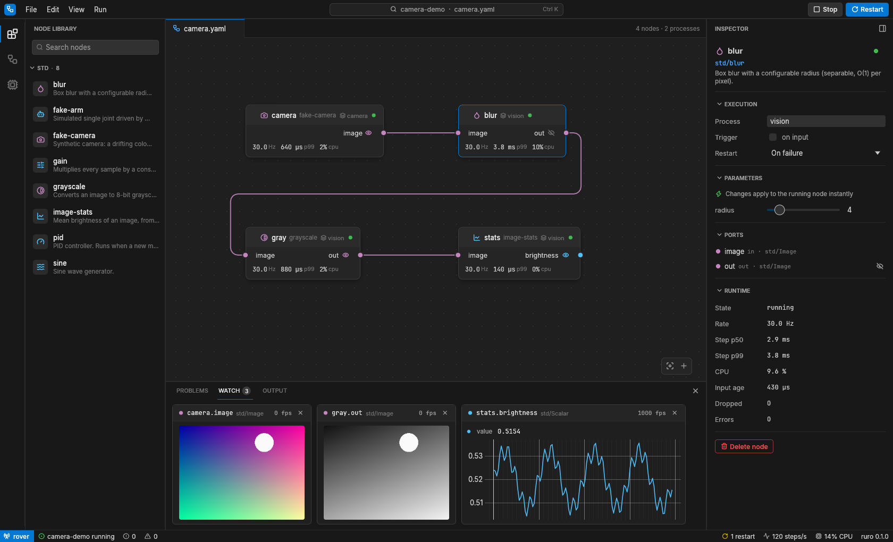

# ruro

Fast, lightweight robotics dataflow in Rust, with a native visual editor.

Build a robot's software as a graph of small nodes (drivers, perception, control) and run it
with zero-copy messaging between nodes in the same process and shared-memory transport
between processes. Design, run and inspect graphs in **ruro studio**, or drive everything from
the `ruro` CLI.



- **Fast.** In-process wires move messages in about 150 ns, whether the message is a number or a
  1080p frame, because messages are shared rather than copied. Cross-process wires use iceoryx2
  shared memory: a few microseconds per hop.
- **Isolated when you want it.** Every node has a *process group*. Nodes in one group share a
  process; separate groups run as separate OS processes, supervised and restarted on crash.
  Regrouping needs no rebuild.
- **Typed.** Ports carry typed messages. Invalid wires are rejected in the editor and before
  deployment.
- **Observable.** Every node reports its rate, step latency (p50/p99), CPU, input age, drops and
  errors. Any output can be watched live: images, plots, values. Watching costs nothing while
  nobody is looking.
- **Remote-ready.** The daemon is a Zenoh router: point the studio at a robot on the network
  and work with it as if it were local.
- **Native.** The studio is a single native Linux binary built with egui. No browser, no
  Electron, no runtime to install.

> ruro is early. The core runtime, node SDK, CLI and studio work end to end; bridges to ROS 2,
> simulators and hardware are next. See [Roadmap](#roadmap).

## Quick start

Requires Rust 1.88+ on Linux.

```sh
git clone https://github.com/mhussainahmad/ruro
cd ruro
cargo build --release

# Open the studio. It starts a local daemon automatically.
./target/release/ruro-studio examples/camera.yaml
```

Press **Run** (or <kbd>Ctrl</kbd>+<kbd>Enter</kbd>). Click the eye next to an output to watch
it live, select a node to tune its parameters while it runs, and press
<kbd>Ctrl</kbd>+<kbd>K</kbd> for the command palette.

Or from a terminal:

```sh
./target/release/ruro run examples/camera.yaml   # deploys, streams logs, Ctrl-C stops
./target/release/ruro status                     # live per-node metrics
./target/release/ruro echo stats.brightness      # print an output's values
./target/release/ruro param blur radius 12       # retune a running node
./target/release/ruro kill camera                # crash a process; watch it come back
```

## Concepts

| | |
|---|---|
| **Node** | A struct with typed input and output ports and parameters. Implements `step`. |
| **Graph** | Node instances and wires, stored as YAML. The studio and the CLI read and write the same file. |
| **Process group** | Nodes that share an OS process. Same group: zero-copy. Different groups: shared memory, crash isolation. |
| **Host** | The binary that runs a group. Every node crate linked into it is available to graphs. |
| **Daemon** | One per machine. Validates and deploys graphs, supervises hosts, serves metrics, logs and live values. |

A graph:

```yaml
name: camera-demo
nodes:
  camera: { type: std/fake-camera, group: camera, rate: 30 }
  blur:   { type: std/blur, group: vision, params: { radius: 4 } }
  stats:  { type: std/image-stats, group: vision }
wires:
  - camera.image -> blur.image
  - blur.out -> stats.image
```

Nodes run on a timer (`rate`) or whenever an input receives data. Each input keeps the newest
message by default; set `depth` on a wire to queue more.

## Writing a node

```rust
use ruro::prelude::*;

/// Multiplies a signal by a constant.
#[derive(Node)]
#[node(kind = "my_robot/gain")]
pub struct Gain {
    #[input]
    input: Input<Scalar>,
    #[output]
    output: Output<Scalar>,
    /// Multiplier applied to every sample.
    #[param(default = 2.0, min = -10, max = 10)]
    k: f64,
}

impl Node for Gain {
    fn step(&mut self, _ctx: &mut Ctx) -> Result {
        while let Some(sample) = self.input.recv() {
            self.output.send(Scalar(sample.0 * self.k))?;
        }
        Ok(())
    }
}
```

The derive generates the node's descriptor: ports, parameter ranges and docs from doc comments.
That is what the studio uses for its library, port colours, type checks and parameter editors.
Custom messages are plain structs:

```rust
#[derive(Message, Serialize, Deserialize, Clone)]
#[message(name = "my_robot/Detection")]
pub struct Detection { pub x: f32, pub y: f32, pub score: f32 }
```

To make your nodes available, build a host that links them and point the daemon at it:

```rust
// my-host/src/main.rs
fn main() {
    my_robot_nodes::link();
    ruro_host::main();
}
```

```sh
ruro daemon --host target/release/my-host
```

## Standard nodes

`std/fake-camera`, `std/blur`, `std/grayscale`, `std/image-stats`, `std/sine`, `std/gain`,
`std/pid`, `std/fake-arm`. They need no hardware and are useful for trying ruro, testing and
benchmarking. Run `ruro nodes -v` for their ports and parameters.

## Performance

Measured with `cargo bench` on a 16-thread x86-64 Linux machine:

| Path | Payload | Time per hop |
|---|---|---|
| In-process | `Scalar` | 143 ns |
| In-process | 1080p RGB image (shared) | 191 ns |
| Shared memory | 8 B | 4.5 µs |
| Shared memory | 640×480 RGB | 26 µs |
| Shared memory | 1080p RGB | 0.7 ms |

```sh
cargo bench -p ruro-node -p ruro-transport
```

## Architecture

```
crates/
  ruro            facade crate for node authors: derives, prelude
  ruro-msg        Message trait and standard types (Image, PointCloud, Pose, JointState, ...)
  ruro-macros     #[derive(Node)], #[derive(Message)]
  ruro-node       ports, queues, parameters, link-time node registry
  ruro-graph      graph YAML, node descriptors, validation
  ruro-transport  iceoryx2 shared-memory topics
  ruro-proto      control protocol over Zenoh (deploy, metrics, taps, params, logs)
  ruro-host       executes one process group: a thread per node, wiring, metrics
  ruro-daemon     per-machine supervisor and Zenoh router
  ruro-cli        `ruro`
  ruro-studio     `ruro-studio`, the desktop editor
nodes/
  ruro-nodes-std  standard node library
```

## Roadmap

- ROS 2 bridge (topics and messages both ways)
- Python node SDK
- Record and replay with a timeline in the studio
- Simulator bridges (MuJoCo, Gazebo) and hardware drivers
- Deterministic real-time executor for kHz control loops
- Multi-machine graphs

## Development

```sh
cargo test --workspace
cargo clippy --workspace --all-targets
# Re-render the studio screenshots headlessly:
RURO_SCREENSHOTS=docs/images cargo test -p ruro-studio screenshots
```

## License

Dual-licensed under [MIT](LICENSE-MIT) or [Apache-2.0](LICENSE-APACHE), at your option.
The studio bundles Inter and JetBrains Mono (SIL OFL 1.1) and Lucide icons (ISC); their
licences are in `crates/ruro-studio/assets`.
