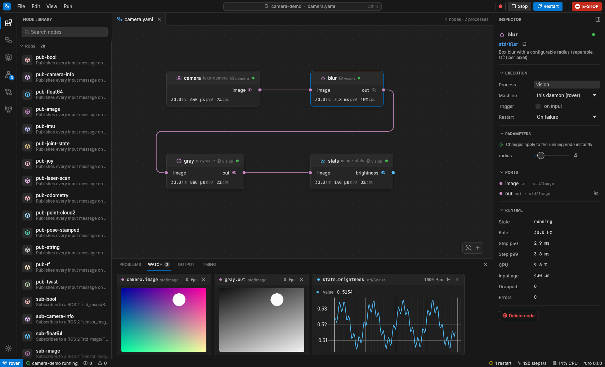
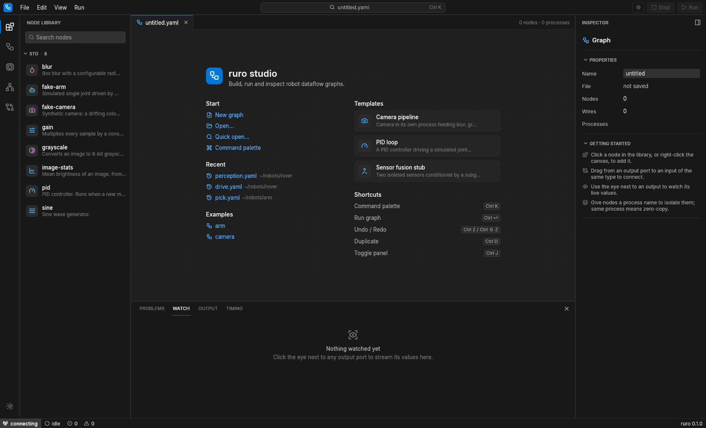
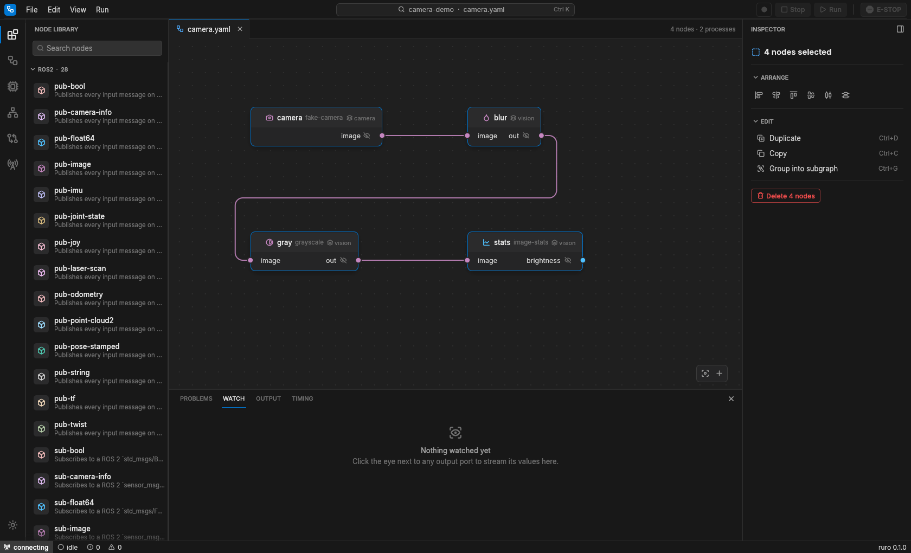
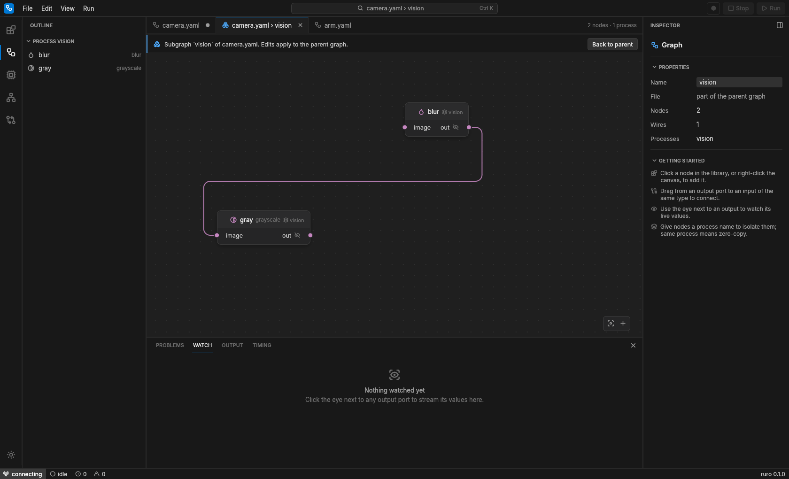
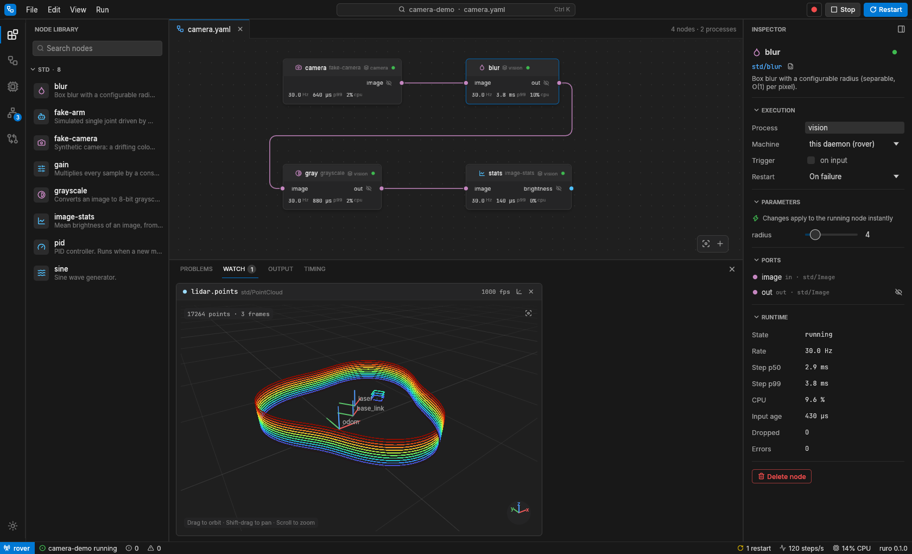
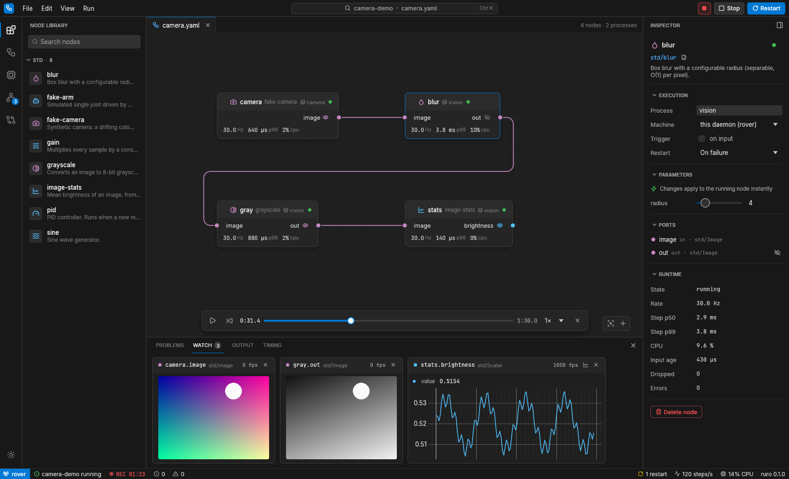
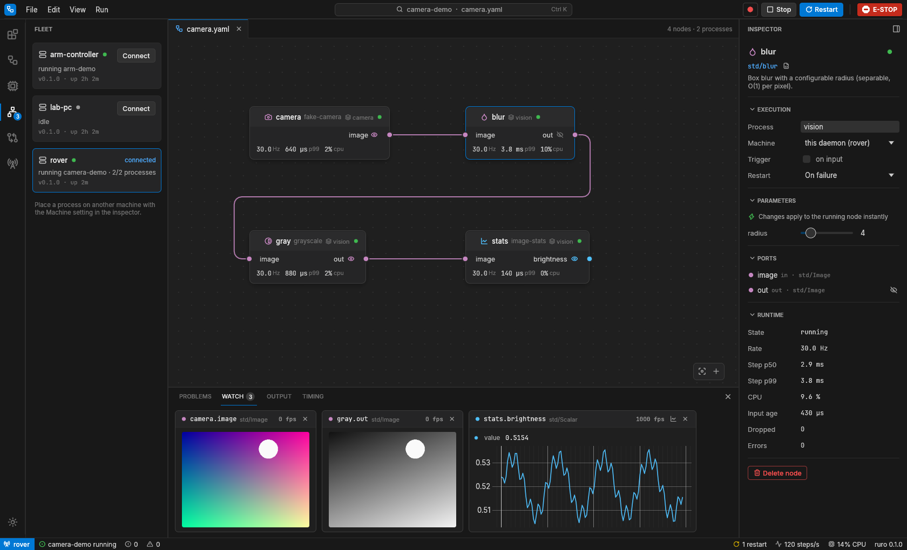
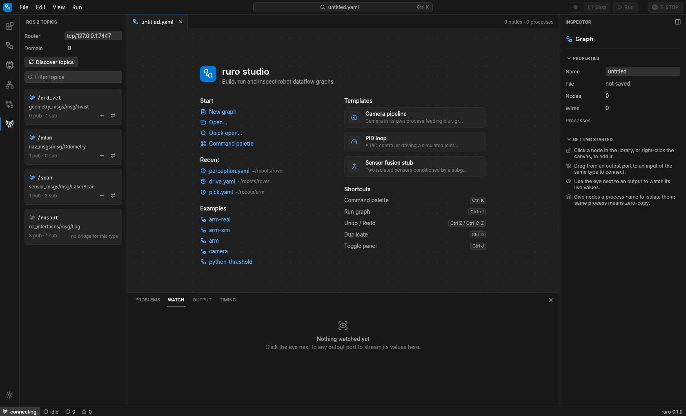
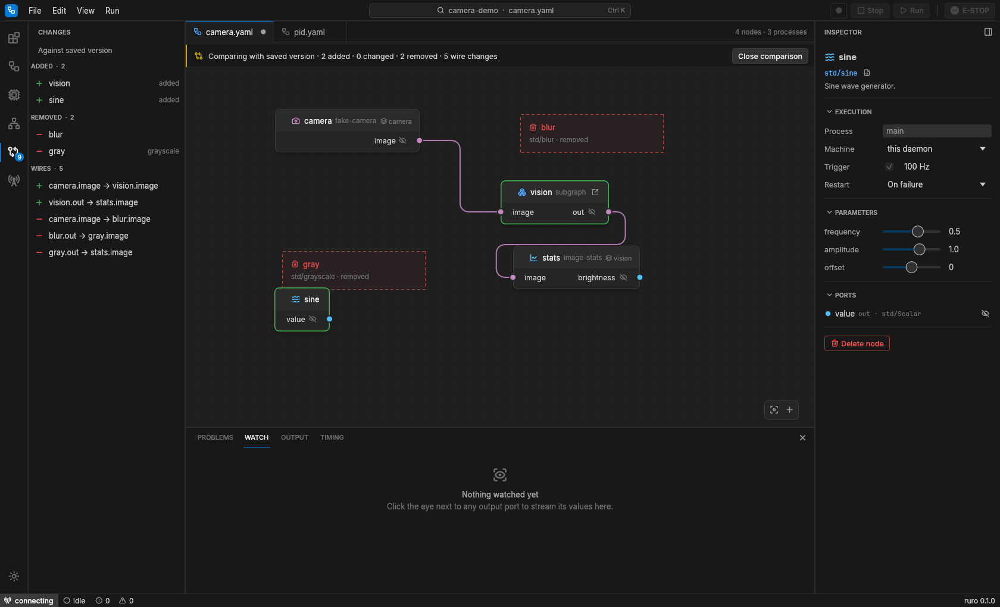
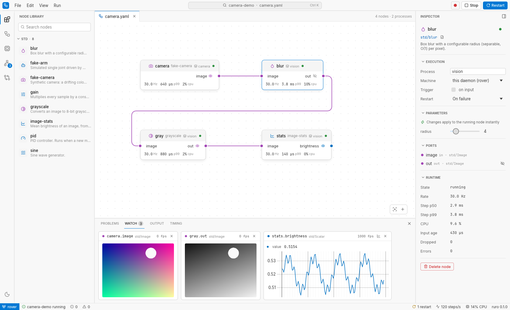

# Studio

ruro studio is the desktop editor for graphs: you build a graph on a canvas, run it, and
inspect it live. It is a single native binary and reads and writes the same YAML files as the
CLI.



## Starting the studio

```sh
ruro-studio [graph.yaml ...]
```

| Option | Meaning |
|---|---|
| `--connect <ENDPOINT>` | Daemon endpoint, e.g. `tcp/192.168.1.20:7447` for a robot. Also `RURO_CONNECT`. Default `tcp/127.0.0.1:7447`. |
| `--daemon <NAME>` | Daemon name, when several share a router. Also `RURO_DAEMON`. Discovered automatically if omitted. |
| `--no-spawn` | Do not start a local daemon when none is running. |
| `--no-native-dialogs` | Use the built-in file picker instead of the desktop's Open and Save dialogs. |
| `--fresh` | Do not reopen the graphs that were open when the studio last closed. |

`ruro studio [args...]` starts the studio from the CLI and passes the arguments through.

When the endpoint is local (`127.0.0.1`, `localhost` or `[::1]`) and no daemon answers, the
studio starts `ruro daemon` itself (from next to its own executable, or from `PATH`). That
daemon stops when the studio exits. If a graph is already running on the daemon and the
canvas is empty, the studio attaches to it and shows it.

The node library is filled from the connected daemon. Before it connects, the studio runs
`ruro-host describe` (next to its executable, or from `PATH`) to list the standard node
types. Python node types appear only when the daemon runs the Python host (see
[Python nodes](python.md)). Graphs open from the command line; without files and without
`--fresh`, the graphs open at the end of the last session are reopened.

## Layout

The window follows the layout of a code editor:

- **Title bar**: the File, Edit, View and Run menus, the command center (click it or press
  <kbd>Ctrl</kbd>+<kbd>K</kbd>), and on the right the record, Stop and Run buttons.
- **Activity bar** on the far left switches the sidebar between the **Node Library**,
  **Outline**, **Processes**, **Fleet**, **Changes** and **ROS 2 Topics** views. The
  sun/moon button at its bottom switches between the dark and light themes.
- **Editor tabs** above the canvas, one per open graph. A dot marks unsaved changes;
  middle-click or <kbd>Ctrl</kbd>+<kbd>W</kbd> closes a tab.
- **Canvas** in the middle, with fit-to-view and add-node buttons in its corner.
- **Inspector** on the right shows the selected node, the selection, or the graph.
- **Panel** at the bottom: Problems, Watch and Output, plus Timing (a built-in
  [plugin](studio-plugins.md) panel).
- **Status bar**: connection, graph state, recording, problem and error counts, process
  restarts, CPU and step rate. Clicking the problem count opens Problems; clicking the error
  count opens Output.

With no nodes on the canvas, a start page offers new graphs, templates, recent files,
examples and the main shortcuts.

**File → Open Example** lists the graphs in an `examples/` directory: the one in the current
directory, or the first one found next to or up to five levels above the studio's
executable. That covers a source checkout, the AppImage and the Flatpak; the Debian package
installs the examples in `/usr/share/doc/ruro/examples/`, which you open with **Open…**.



## Building a graph

- **Add nodes** from the library (click an entry), from the canvas context menu (right-click),
  or from the command palette (type the node's name). Dropping a wire on empty canvas offers the
  node types that can accept it.
- **Connect** by dragging from an output port to an input port. Ports are coloured by message
  type; wires between different types are refused.
- **Select** several nodes with shift-click or a shift-drag rectangle, or everything with
  <kbd>Ctrl</kbd>+<kbd>A</kbd>. Dragging a shift-selected node moves the others with it. The
  inspector then offers align and distribute, duplicate, copy, grouping and delete.
- **Copy and paste** with <kbd>Ctrl</kbd>+<kbd>C</kbd>/<kbd>X</kbd>/<kbd>V</kbd>. Nodes go to
  the system clipboard as graph YAML, wires between copied nodes included, so they can be pasted
  into another graph or a text editor. <kbd>Ctrl</kbd>+<kbd>D</kbd> duplicates.
- **Undo and redo** every edit with <kbd>Ctrl</kbd>+<kbd>Z</kbd> and
  <kbd>Ctrl</kbd>+<kbd>Shift</kbd>+<kbd>Z</kbd> (or <kbd>Ctrl</kbd>+<kbd>Y</kbd>). A drag or a
  slider scrub is one step. Each tab has its own history.
- **Templates**: File → New from Template starts from an empty graph, a camera pipeline, a
  PID loop or a sensor fusion stub.
- **Right-click a node** for Watch All Outputs, Run in Its Own Process, Open Node Source,
  Duplicate, Group into Subgraph and Delete.



## The inspector

With one node selected the inspector shows:

- **Execution**: the process group the node runs in, the **machine** (daemon) that runs that
  process, the trigger (timer rate or "on input") and the restart policy. The machine list
  offers every daemon seen on the network; it is stored in the graph's `groups` settings.
- **Parameters** with editors chosen from the parameter type and range. While the graph runs,
  changes apply to the running node immediately.
- **Ports**, with a toggle to watch each output.
- **Runtime** metrics while the graph runs: state, rate, step time p50/p99, CPU, input age,
  dropped messages and errors.

The file icon next to the node type opens the node's Rust source in your editor (VS Code,
VSCodium, Cursor or Zed when installed, otherwise `$VISUAL`, otherwise the default
application). The command palette's **Open Node Source** does the same.

With nothing selected the inspector shows the graph's name, file, node and wire counts and
process groups.

## Subgraphs

Select some nodes and choose **Group into Subgraph** (<kbd>Ctrl</kbd>+<kbd>G</kbd>). They become
one composite node whose ports are the wires that crossed the selection. **Open Subgraph** (the
icon in the node header) edits it in its own tab; edits apply to the parent graph, which you
save as usual. **Ungroup** puts the nodes back. Composite parameters (`inner.param`) can be set on
the composite node itself.

Nodes can also reference a subgraph file, `type: graph:path/to/sub.yaml`; opening one opens the
file. See [Composite nodes](reference/composites.md) for the file format.



## Running and watching

Press **Run** (<kbd>Ctrl</kbd>+<kbd>Enter</kbd>). The studio validates the graph, shows any
problems in the Problems panel (click one to select its node), flattens subgraphs and deploys
the graph to the daemon. While it runs, nodes show their rate, step time and CPU, and the Run
button becomes **Apply changes** after a structural edit.

Click the eye next to an output to **watch** it. Each watch is a tile in the Watch panel whose
view depends on the data:

| Data | Views (default first) |
|---|---|
| Images | Image |
| Numbers (scalars, vectors, joint states, any numeric message) | Plot, Values, Text |
| Point clouds, laser scans | 3D, Text |
| Poses, odometry, transforms | 3D, Text |
| Anything else | Text |

When more than one view fits, switch with the icon in a tile's header. The **3D view** draws points coloured by height
on a ground grid, every coordinate frame as an axis triad with its name, and the path of moving
poses. Drag to orbit, shift-drag (or right- or middle-drag) to pan, scroll to zoom, and
double-click to frame everything.



The **Output** panel shows logs from every process, with a filter. **Timing** ranks running
nodes by step time. The **Processes** view lists process groups with their PIDs, restarts and
last exit, and can kill a process to test supervision.

## Recording and replay

While a graph runs, the record button in the title bar asks for a file name (by default
`<graph>-<date>-<time>.mcap`) and records every output of the running graph to that MCAP
file on the daemon (the path is on the daemon's machine, which may be the robot). While
recording, the status bar shows a pulsing **REC** with the elapsed time; click it, or the
button, to stop.

**Run → Replay Recording…** asks for the path of a recording on the daemon and replays it.
While it plays, a timeline at the bottom of the canvas has play/pause, back to start, a seek
bar, the position and length, the playback speed (0.25× to 4×) and a button that stops the
replay. See [Record and replay](record-replay.md) for what replay does to the graph.



The studio has no emergency-stop control; use `ruro estop` (see
[Runtime features](runtime.md#emergency-stop)).

## Fleet

The **Fleet** view lists every daemon the connected daemon can see, with the graph it runs, its
processes and uptime. **Connect** switches the studio to another daemon. Clicking the
connection indicator in the status bar opens this view.



## ROS 2 topics

The **ROS 2 Topics** view lists the topics of a ROS 2 system that uses rmw_zenoh. Set the
**Router** (default `tcp/127.0.0.1:7447`, independent of the daemon connection) and the
**Domain** (default from `ROS_DOMAIN_ID`), then press **Discover topics**. Each topic shows
its type and its publisher and subscriber counts; for the
[supported types](ros2.md#message-types), buttons add a `ros2/sub-*` or `ros2/pub-*` bridge
node for it to the graph, with its topic, domain, router and QoS filled in.



## Comparing versions

**File → Compare with Saved** compares the open graph with the file on disk; **Compare with
File…** compares it with another graph. The Changes view lists added, changed and removed nodes,
parameter changes and wire changes. On the canvas, added nodes have a green border, changed
nodes an amber one, and removed nodes appear as dashed outlines where they were.



## Files, settings and recovery

**Open**, **Save As** and **Compare with File…** use the desktop's file dialogs through the
XDG desktop portal. If no portal answers, the studio falls back to its built-in file picker
(always used with `--no-native-dialogs`).
**Quick Open** (<kbd>Ctrl</kbd>+<kbd>P</kbd>) is a keyboard file picker with recent files.

Settings live in `$XDG_CONFIG_HOME/ruro/studio.json` (usually `~/.config/ruro/`): theme, panel
sizes and visibility, collapsed sections, recent files and the graphs that were open. Unsaved
graphs are written to `$XDG_STATE_HOME/ruro/autosave/` every 20 seconds and when the studio
closes; after a crash or when closing with unsaved work, the next start offers to restore them.

## Themes

The studio has a dark and a light theme. Switch with the button at the bottom of the activity
bar, View → Theme, or the command palette. The choice is remembered.



## Keyboard shortcuts

| Action | Keys |
|---|---|
| Command palette | <kbd>Ctrl</kbd>+<kbd>K</kbd> or <kbd>Ctrl</kbd>+<kbd>Shift</kbd>+<kbd>P</kbd> |
| Run / apply changes | <kbd>Ctrl</kbd>+<kbd>Enter</kbd> |
| New, open, quick open | <kbd>Ctrl</kbd>+<kbd>N</kbd>, <kbd>Ctrl</kbd>+<kbd>O</kbd>, <kbd>Ctrl</kbd>+<kbd>P</kbd> |
| Save, save as | <kbd>Ctrl</kbd>+<kbd>S</kbd>, <kbd>Ctrl</kbd>+<kbd>Shift</kbd>+<kbd>S</kbd> |
| Close tab, next tab | <kbd>Ctrl</kbd>+<kbd>W</kbd>, <kbd>Ctrl</kbd>+<kbd>Tab</kbd> |
| Undo, redo | <kbd>Ctrl</kbd>+<kbd>Z</kbd>, <kbd>Ctrl</kbd>+<kbd>Shift</kbd>+<kbd>Z</kbd> |
| Cut, copy, paste, duplicate | <kbd>Ctrl</kbd>+<kbd>X</kbd>/<kbd>C</kbd>/<kbd>V</kbd>/<kbd>D</kbd> |
| Select all, delete | <kbd>Ctrl</kbd>+<kbd>A</kbd>, <kbd>Del</kbd> or <kbd>Backspace</kbd> |
| Group into subgraph | <kbd>Ctrl</kbd>+<kbd>G</kbd> |
| Fit graph to view | <kbd>Ctrl</kbd>+<kbd>0</kbd> |
| Toggle sidebar, panel, inspector | <kbd>Ctrl</kbd>+<kbd>B</kbd>, <kbd>Ctrl</kbd>+<kbd>J</kbd>, <kbd>Ctrl</kbd>+<kbd>I</kbd> |

## Extending the studio

Visualizers for watched ports and bottom-panel tabs can be added in Rust; see
[Studio plugins](studio-plugins.md).
